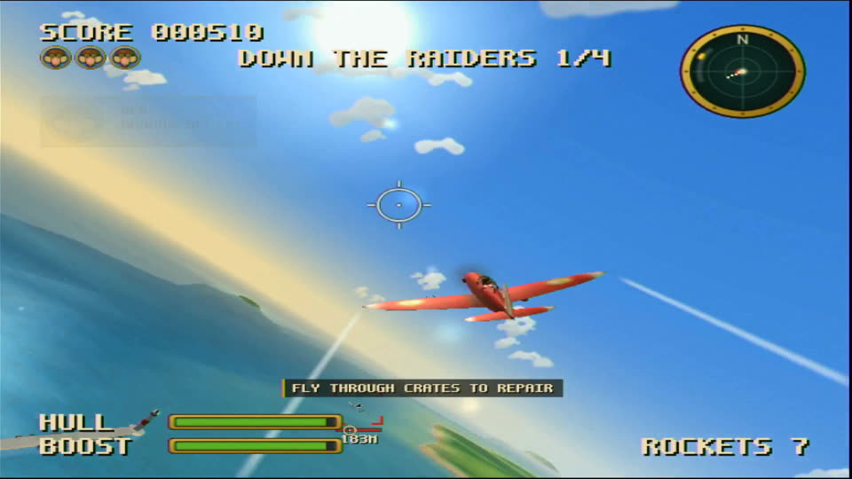

# RedBaboon

A 3D arcade dogfighting game for the original Xbox, written in C++20 with [nxdk](https://github.com/XboxDev/nxdk).

You are Captain "Red" Baboon, a flying ace in a crimson fighter. Gorilla sky pirates are raiding the banana
plantations of Isla Platano: shoot them down with banana machine guns and banana rockets, fly the canyon rings for
bonus points, and bring down their zeppelin, the Silverback.



- One level, "Raid on Isla Platano": three waves of pirates, an optional canyon run and a zeppelin boss, about 8-12
  minutes.
- Everything is made by code at start-up: meshes, textures, music and sound effects. The game is a single
  `default.xbe` with no data files.
- Its own renderer on the NV2A through pbkit, at 60 fps in 480p (480i without the HDTV pack). Its own synthesizer and
  mixer drive the AC'97 on a console and play through an APU voice in xemu.
- Runs in [xemu](https://xemu.app) and on any original Xbox that runs homebrew.

## Try it now

Download the latest build from [Releases](https://github.com/kooscode/redbaboon/releases/latest):

- **xemu:** `RedBaboon.iso`. Load it with Machine > Load Disc. Keep xemu's "Use DSP" audio setting off (the default),
  or the game is silent.
- **Xbox:** `default.xbe`. Copy it into a folder of its own on the console (e.g. `F:\Games\RedBaboon\default.xbe`)
  and start it from your dashboard. Works on every console revision (1.0-1.6) with a softmod or modchip.

## Controls

| Input | Action |
|---|---|
| Left stick | Pitch and turn (the plane banks into turns and levels its wings when released) |
| Right stick | Up: boost, down: brake; left/right: rudder |
| Right trigger | Banana machine guns |
| Left trigger | Banana rocket |
| A | Stunt: loop, Immelmann turn or barrel roll, by the left stick's direction |
| B | Next target |
| X (hold) | Target view |
| Y (hold) | Look back |
| White / Black | Chase / close chase camera |
| Start | Pause |
| Back | Objective and score |

The full list is in [docs/design.md](docs/design.md) §3; the game shows it too, before the mission starts.

## Building

You need:
- nxdk with its tools built (`make -C $NXDK_DIR tools`), and clang and lld on `PATH` (LLVM 18 is known to work);
- the SDL3 submodule: `git submodule update --init --recursive`;
- for the host tests, g++ or clang.

Tell the Makefile where nxdk is, in the environment or in a `local.mk` (not in git) next to the Makefile:

```make
NXDK_DIR = /path/to/nxdk
export PATH := /usr/lib/llvm-18/bin:$(PATH)
```

Then:

| Command | What it does |
|---|---|
| `make` | builds the game: `build/RedBaboon/default.xbe` |
| `make iso` | `build/RedBaboon.iso`, an XISO to load in xemu |
| `make test` | builds and runs the host tests: flight model, a headless simulation of whole missions, the seed parser |
| `make demos` | the renderer and audio test titles: `build/RenderDemo/`, `build/AudioDemo/` |
| `make preview` | renders the procedural meshes and textures to PNG files in `build/preview/` |
| `make audio_render` | renders every sound effect and music track to WAV files in `build/audio/` |
| `make audio_game` | runs the game's audio through a whole mission on the PC: `build/audio/game_path.wav` |
| `make clean` | deletes `build/` |

Everything a build writes goes under `build/`.

## Running your own build

- **xemu:** load `build/RedBaboon.iso` (Machine > Load Disc). Keep xemu's "Use DSP" audio setting off (the default),
  or the game is silent.
- **Xbox:** copy the `build/RedBaboon` folder to the console's games folder (e.g. `F:\Games\RedBaboon`) and start it
  from your dashboard.
- **Development rigs:** `make xemu` boots the game in xemu on the [OXOS](https://github.com/kooscode/oxos) kernel
  with its serial log ([docs/xemu.md](docs/xemu.md)); `make hardware` installs, runs and records it on a real Xbox
  with a Modxo modchip ([docs/hardware.md](docs/hardware.md)). Both need an OXOS checkout (`OXOS_DIR`).
- **Self-play:** an `autoplay.txt` next to `default.xbe` makes the game fly itself, for testing and recordings;
  `seed=fixed` in it gives the same mission every run ([docs/design.md](docs/design.md) §9).

## Source layout

| Folder | What |
|---|---|
| `src/core/` | vector maths and the mesh and image types shared by everything |
| `src/render/` | the renderer: pbkit on the NV2A, with Cg shaders in `shaders/` |
| `src/audio/` | synthesizer, sound effects, music, mixer, and the AC'97 and APU output |
| `src/content/` | the procedural content: island, sea, planes, zeppelin, props, textures, HUD art |
| `src/game/` | flight model, AI, weapons, mission, camera, HUD and menus |
| `src/platform/` | controller input through SDL3 |
| `tests/host/` | host tests and audio checks, with null renderer, audio and input |
| `tests/render_demo/`, `tests/audio_demo/` | Xbox test titles for the renderer and the audio |
| `tools/preview/` | host preview of the procedural content (a small software rasteriser) |
| `tools/xemu/`, `tools/hardware/` | the xemu and real-Xbox test rigs |
| `docs/` | design, C++ style, the rigs, and the creative brief and reviews (`docs/creative/`) |
| `third_party/nxdk-sdl3/` | SDL3 for nxdk (submodule) |

The code follows [docs/cpp_style.md](docs/cpp_style.md).

## How it was made

RedBaboon was built 100 % by [Claude Code](https://claude.com/claude-code): design, code, art, music, sound and
testing, in about 18 hours from the first commit to the first release. It is about **28,000 lines of C++** (24,600 for
the game itself) and 218 lines of Cg shaders, with no hand-made assets and no human-written code.

**A studio of agents.** A lead session wrote the design document, the style guide and the interfaces between the
parts, then ran four specialist agents in parallel, each in its own git worktree and owning one folder:
**graphics** (the pbkit renderer), **content** (every mesh and texture, generated by code), **audio** (synthesizer,
music, effects, the AC'97 and APU drivers) and **game** (flight model, AI, mission, HUD, menus). The lead merged their
branches, sorted out conflicts between them and decided what to work on next.

**A creative director.** A separate agent played a demanding game critic. It watched each hardware recording,
listened to its audio, graded the build against a creative brief and a detail checklist, and wrote a review with
timestamps and concrete fixes for each agent. Six rounds took the game from **5.5 to 8.5 out of 10**, where the
director called it done. The reviews are in [docs/creative/](docs/creative/).

**Fast iteration in xemu.** The xemu rig boots the open-source [OXOS](https://github.com/kooscode/oxos) kernel
straight into a fresh build in about 10 seconds, with the game's debug log on the serial port, screenshots over QMP
and a virtual controller, so the agents could test without a human. That came to over **100 xemu boots** and hundreds
of screenshots.

**Hardware in the loop.** Then every build that mattered ran on a real Xbox, unattended. A Modxo modchip lets the PC
power the console on and off, netboot the OXOS kernel with an FTP app, install the build, launch it and read its
serial log, while a capture card records the console's video and audio. That came to **89 power cycles and installs**
and **32 recordings** (4.7 GB). The console caught what an emulator never would: frames drawn into the buffer being
shown, a sound bug that left some boots silent, a stack overflow, and frame-time spikes. The game reached a steady 60
fps on the real hardware, with sound on every boot.

## Credits and license

RedBaboon is GPL-2.0 ([`LICENSE`](LICENSE)). Built with [nxdk](https://github.com/XboxDev/nxdk) (pbkit, the
toolchain and runtime) and [nxdk-sdl3](https://github.com/Ryzee119/nxdk-sdl3) ([SDL3](https://libsdl.org) for nxdk).
